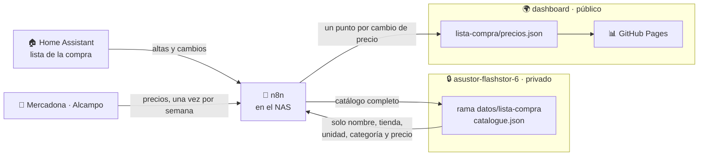

<div align="center">

# 📊 Paneles

**Paneles de datos de casa, servidos con GitHub Pages**

[](https://moilolon.github.io/dashboard/)

[](https://pages.github.com/)
[](#-cómo-está-hecho)
[](https://n8n.io/)
[](https://www.home-assistant.io/)

[Paneles](#-paneles) ·
[Arquitectura](#-arquitectura) ·
[Estructura](#-estructura) ·
[Cómo está hecho](#-cómo-está-hecho) ·
[Los datos](#-los-datos) ·
[Qué es público](#-qué-es-público)

</div>

---

## ✨ Qué es esto

Un sitio estático con **paneles que pintan datos de casa**. No hay servidor ni
compilación: lo que hay en la rama `main` es el sitio, y GitHub Pages lo sirve en

### 👉 https://moilolon.github.io/dashboard/

Los datos no se editan aquí a mano. Los escribe n8n desde el NAS de casa, y cada panel
los lee al cargar.

---

## 📊 Paneles

| | Panel | Qué enseña | Dirección |
|---|---|---|---|
| 🛒 | **Precios de la compra** | Cómo cambian los precios de los productos del catálogo en Mercadona y Alcampo | [`/lista-compra/`](https://moilolon.github.io/dashboard/lista-compra/) |

---

## 🧭 Arquitectura



> [!NOTE]
> El catálogo de verdad vive en el repo privado. Aquí solo llega el historial de
> precios, que es lo que pinta el panel.

---

## 📁 Estructura

```text
dashboard/
├── 🏠 index.html          Portada: una tarjeta por panel
├── 🎨 estilos.css         Estilos comunes, en claro y en oscuro
├── 🛒 lista-compra/       Panel de precios de la compra
│   ├── index.html
│   ├── panel.js           Lee precios.json y pinta sin bibliotecas
│   └── precios.json       Los datos: los escribe n8n
├── 🤖 robots.txt          Pide a los buscadores que no indexen el sitio
└── 📄 .nojekyll           Hace que GitHub sirva los ficheros tal cual
```

| Si quieres… | Ve a |
|---|---|
| Ver los paneles | [moilolon.github.io/dashboard](https://moilolon.github.io/dashboard/) |
| Cambiar cómo se ve todo | [`estilos.css`](estilos.css) |
| Cambiar el panel de precios | [`lista-compra/panel.js`](lista-compra/panel.js) |
| Añadir un panel | [Cómo está hecho](#-cómo-está-hecho) |

---

## 🚀 Cómo está hecho

<details>
<summary><b>1 · Publicación</b></summary>

GitHub Pages sirve la raíz de la rama `main` (*Settings → Pages → Deploy from a
branch*). Cada commit se publica solo en alrededor de un minuto; GitHub lo enseña en
*Actions* como «pages build and deployment». No hay workflows propios.

</details>

<details>
<summary><b>2 · Un panel por carpeta</b></summary>

Cada panel es una carpeta con su `index.html`, su JavaScript y su fichero de datos. La
página enlaza `../estilos.css`, pide su JSON al cargar y pinta en el navegador. Las
gráficas son SVG hecho a mano: no hay bibliotecas ni dependencias que actualizar.

</details>

<details>
<summary><b>3 · Añadir un panel</b></summary>

1. Crear una carpeta con su `index.html` y enlazar `../estilos.css`.
2. Dejar sus datos en un JSON dentro de la carpeta.
3. Añadir su tarjeta a `index.html` y su fila a la tabla de [Paneles](#-paneles).

</details>

<details>
<summary><b>4 · Probarlo en local</b></summary>

Hace falta un servidor, porque el navegador no deja leer el JSON abriendo el fichero
directamente:

```bash
python -m http.server 8765
```

Y abrir `http://localhost:8765/`.

</details>

---

## 🗂️ Los datos

Los escribe n8n con la GitHub App `moilolon-datos`, al terminar cada lectura de precios
en la tienda: Mercadona los lunes y Alcampo los martes. Sus commits se llaman
`Precios: N cambios`.

`lista-compra/precios.json` guarda **un punto por producto solo cuando su precio
cambia**:

```json
{ "actualizado": "2026-11-12",
  "productos": { "mercadona:4706": {
    "nombre": "Aceite de oliva", "tienda": "Mercadona", "unidad": "ud",
    "categoria": "Aceite, especias y salsas", "activo": true,
    "precios": [["2026-11-12", 5.25]] } } }
```

| Campo | Qué es |
|---|---|
| Clave | La tienda y el código del producto en ella. Un cambio de nombre no parte el historial |
| `unidad` | `ud` o `kg`: el precio es por unidad o por kilo |
| `activo` | `false` cuando el producto sale del catálogo; deja de pintarse y conserva su historial |
| `precios` | Pares de fecha y precio. Un precio vale hasta el punto siguiente |

---

## 🔓 Qué es público

Este repo y su sitio son **públicos**. Por eso aquí solo llegan el nombre, la tienda,
el código en la tienda, la unidad, la categoría y los precios. Las cantidades, las
sugerencias y el resto del catálogo se quedan en el repo privado.

> [!IMPORTANT]
> Lo que se publica aquí queda en el historial aunque luego se borre. Antes de añadir
> un dato nuevo a un panel, hay que decidir si puede ser público.

---

<div align="center">
<sub>Las páginas piden a los buscadores que no las indexen, pero cualquiera con la dirección puede verlas.</sub>
</div>
