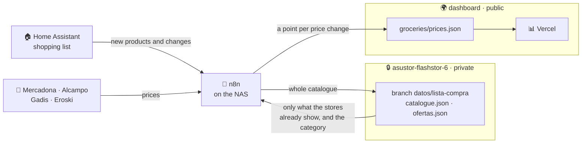

<div align="center">

# 📊 Dashboards

**Dashboards of home data, served with Vercel**

[](https://dashboard.moilolon.com/)

[](https://vercel.com/)
[](#-how-it-works)
[](https://n8n.io/)
[](https://www.home-assistant.io/)

[Dashboards](#-dashboards-1) ·
[Architecture](#-architecture) ·
[Structure](#-structure) ·
[How it works](#-how-it-works) ·
[The data](#-the-data) ·
[What is public](#-what-is-public)

</div>

---

## ✨ What this is

A static site with **dashboards that draw data from home**. There is no server and no
build step: what is on the `main` branch is the site.

The data is not edited here by hand. n8n writes it from the NAS at home, and each
dashboard reads it when it loads.

---

## 📊 Dashboards

| | Dashboard | What it shows | Address |
|---|---|---|---|
| 🏠 | **Summary** | A card per dashboard with its figures, and alerts of what has changed | [`/`](https://dashboard.moilolon.com/) |
| 🛒 | **Groceries** | What each product of the catalogue costs at Mercadona, Alcampo, Gadis and Eroski, which store is cheapest and how the prices change | [`/groceries/`](https://dashboard.moilolon.com/groceries/) |

---

## 🧭 Architecture



> [!NOTE]
> The real catalogue lives in the private repo. Only the price history gets here, which
> is what the dashboard draws.

---

## 📁 Structure

```text
dashboard/
├── 🏠 index.html          Summary: a card per dashboard and the alerts
├── 🎨 styles.css          Shared styles: cool and warm themes, light and dark
├── 🧩 common.js           Settings, language, menu, formats and charts shared by all
├── 🌍 i18n.js             The texts of the site, in English and Spanish
├── 🛒 groceries/          Dashboard of grocery prices
│   ├── index.html
│   ├── dashboard.js       Reads prices.json and draws
│   └── prices.json        The data: n8n writes it
├── 🖼️ favicon.svg         The icon of the tab, the same as moilolon.com
└── 🤖 robots.txt          Asks search engines not to index the site
```

| If you want to… | Go to |
|---|---|
| See the dashboards | [dashboard.moilolon.com](https://dashboard.moilolon.com/) |
| Change the colours or the look of everything | [`styles.css`](styles.css) |
| Change the menu or the settings | [`common.js`](common.js) |
| Change or translate a text | [`i18n.js`](i18n.js) |
| Change the groceries dashboard | [`groceries/dashboard.js`](groceries/dashboard.js) |
| Add a dashboard | [How it works](#-how-it-works) |

---

## 🚀 How it works

<details>
<summary><b>1 · Publishing</b></summary>

Vercel serves the root of the `main` branch as it is, with no framework and no build
command, at `dashboard.moilolon.com`. The project is connected to this repo, so every
commit is published on its own in a few seconds, including the ones n8n makes.

`common.js` loads Vercel Web Analytics and Speed Insights on the published site only.

</details>

<details>
<summary><b>2 · One dashboard per folder</b></summary>

Each dashboard is a folder with its `index.html`, its JavaScript and its data file. The
page loads `../styles.css`, `../i18n.js` and `../common.js`, fetches its JSON on load
and draws in the browser. The charts are hand-written SVG: there are no libraries or
dependencies to update.

</details>

<details>
<summary><b>3 · Menu and settings</b></summary>

`common.js` draws the menu on every page from a list, and the **Settings** panel:
language, cool or warm theme, automatic, light or dark mode, menu on the side or at the
top, and full or narrow width. The settings are saved in each visitor's browser, not in
the repo.

Language and mode are shared with the other sites under `moilolon.com`: they are also
kept in two cookies of the whole domain, `moilolon-lang` and `moilolon-theme`, which win
over what was saved here. The automatic mode removes `moilolon-theme`.

The name of the site, at the start of the menu, is the switcher shared by every site
under `moilolon.com`: it opens the list of them. It is the `<moilolon-nav>` element,
loaded from `https://moilolon.com/nav.js` and kept in the
[`home`](https://github.com/moilolon/home) repo.

</details>

<details>
<summary><b>4 · Languages</b></summary>

The site is in English and Spanish. It starts in the language of the browser and it is
changed in **Settings**. Every text lives in `i18n.js`, once per language, and the
pages ask for it by key: `data-i18n="groceries.products"` in the HTML and
`t('groceries.products')` in JavaScript. Numbers and dates follow the language too.

Product names and categories are not translated: they come with the data, as they are
written in the catalogue.

</details>

<details>
<summary><b>5 · Embedding a dashboard</b></summary>

Adding `?embed=1` to an address hides the menu, to show the page inside another one,
such as a Home Assistant view. The same address can fix the settings of that frame,
without touching the saved ones:

```text
https://dashboard.moilolon.com/groceries/?embed=1&lang=es&mode=dark
```

It accepts `lang` (`en`, `es`), `theme` (`cool`, `warm`), `mode` (`auto`, `light`,
`dark`) and `width` (`narrow`, `full`).

</details>

<details>
<summary><b>6 · Adding a dashboard</b></summary>

1. Create a folder with its `index.html`, loading `../styles.css`, `../i18n.js` and
   `../common.js`.
2. Leave its data in a JSON file inside the folder.
3. Add its entry to the `MENU` list in `common.js`.
4. Add its texts to `i18n.js`, in both languages.
5. Add its card to the summary, in `index.html`, and its row to the table of
   [Dashboards](#-dashboards-1).

</details>

<details>
<summary><b>7 · Trying it locally</b></summary>

A server is needed, because the browser does not allow reading the JSON by opening the
file directly:

```bash
python -m http.server 8765
```

Then open `http://localhost:8765/`.

</details>

---

## 🗂️ The data

n8n writes it with the GitHub App `moilolon-datos`, at the end of each reading of the
prices at the stores. Its commits are named `Prices: N changes`.

`groceries/prices.json` has **an entry per offer**, a product at a store, and keeps **a
point only when its price changes**:

```json
{ "updated": "2026-11-12",
  "products": { "mercadona:4706": {
    "name": "Aceite de oliva", "store": "Mercadona", "unit": "ud",
    "category": "Aceite, especias y salsas", "active": true,
    "article": "Aceite de oliva virgen extra Hacendado", "image": "https://…",
    "ref": [5.25, "l"],
    "prices": [["2026-11-12", 5.25]] } } }
```

| Field | What it is |
|---|---|
| Key | The store and the code of the article in it. Renaming a product does not split its history |
| `name` | The product in the catalogue. The offers with the same name are the same product at several stores, and the page draws them on one card |
| `unit` | `ud` or `kg`: the price is per unit or per kilo |
| `active` | `false` when the offer leaves the catalogue; it stops being drawn and keeps its history |
| `article` | The name of the article at the store. Optional |
| `image` | The address of its photo at the store. Optional |
| `ref` | Its current reference price and the unit of it: per kilo, per litre… Optional |
| `prices` | Pairs of date and price. A price holds until the next point |

### Comparing stores

The offers of a product are compared by their reference price when all of them give it
in the same unit, and by the price of the pack otherwise. The basket is each product at
its cheapest store.

Each line of a card is a link to the article at its store. The address comes from the
code, in `storeLink` of `common.js`. Gadis has no address by code: its pages are named
after the article, so its link comes from `article`.

A new store is a line in `STORES` and a case in `storeLink`, both in `common.js`, and
its colour in `styles.css`.

---

## 🔓 What is public

This repo and its site are **public**. That is why only what each store already shows
of an article gets here (its name, code, photo and prices), with the name, the unit and
the category it has in the catalogue. The quantities, the suggestions and the rest of
the catalogue stay in the private repo.

> [!IMPORTANT]
> Whatever is published here stays in the history even if it is deleted later. Before
> adding a new piece of data to a dashboard, decide whether it can be public.

---

<div align="center">
<sub>The pages ask search engines not to index them, but anyone with the address can see them.</sub>
</div>
