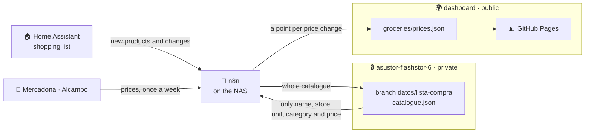

<div align="center">

# 📊 Dashboards

**Dashboards of home data, served with GitHub Pages**

[](https://moilolon.github.io/dashboard/)

[](https://pages.github.com/)
[](#-how-it-works)
[](https://n8n.io/)
[](https://www.home-assistant.io/)

[Dashboards](#-dashboards-1) ·
[Architecture](#-architecture) ·
[Structure](#-structure) ·
[How it works](#-how-it-works) ·
[The data](#-the-data) ·
[What is public](#-what-is-public)

</div>

---

## ✨ What this is

A static site with **dashboards that draw data from home**. There is no server and no
build step: what is on the `main` branch is the site.

The data is not edited here by hand. n8n writes it from the NAS at home, and each
dashboard reads it when it loads.

---

## 📊 Dashboards

| | Dashboard | What it shows | Address |
|---|---|---|---|
| 🏠 | **Summary** | A card per dashboard with its figures, and alerts of what has changed | [`/`](https://moilolon.github.io/dashboard/) |
| 🛒 | **Groceries** | How the prices of the products in the catalogue change at Mercadona and Alcampo | [`/groceries/`](https://moilolon.github.io/dashboard/groceries/) |

---

## 🧭 Architecture



> [!NOTE]
> The real catalogue lives in the private repo. Only the price history gets here, which
> is what the dashboard draws.

---

## 📁 Structure

```text
dashboard/
├── 🏠 index.html          Summary: a card per dashboard and the alerts
├── 🎨 styles.css          Shared styles: cool and warm themes, light and dark
├── 🧩 common.js           Settings, language, menu, formats and charts shared by all
├── 🌍 i18n.js             The texts of the site, in English and Spanish
├── 🛒 groceries/          Dashboard of grocery prices
│   ├── index.html
│   ├── dashboard.js       Reads prices.json and draws
│   └── prices.json        The data: n8n writes it
├── 🤖 robots.txt          Asks search engines not to index the site
└── 📄 .nojekyll           Makes GitHub serve the files as they are
```

| If you want to… | Go to |
|---|---|
| See the dashboards | [moilolon.github.io/dashboard](https://moilolon.github.io/dashboard/) |
| Change the colours or the look of everything | [`styles.css`](styles.css) |
| Change the menu or the settings | [`common.js`](common.js) |
| Change or translate a text | [`i18n.js`](i18n.js) |
| Change the groceries dashboard | [`groceries/dashboard.js`](groceries/dashboard.js) |
| Add a dashboard | [How it works](#-how-it-works) |

---

## 🚀 How it works

<details>
<summary><b>1 · Publishing</b></summary>

GitHub Pages serves the root of the `main` branch (*Settings → Pages → Deploy from a
branch*). Every commit is published on its own in about a minute; GitHub shows it under
*Actions* as "pages build and deployment". There are no workflows of its own.

</details>

<details>
<summary><b>2 · One dashboard per folder</b></summary>

Each dashboard is a folder with its `index.html`, its JavaScript and its data file. The
page loads `../styles.css`, `../i18n.js` and `../common.js`, fetches its JSON on load
and draws in the browser. The charts are hand-written SVG: there are no libraries or
dependencies to update.

</details>

<details>
<summary><b>3 · Menu and settings</b></summary>

`common.js` draws the menu on every page from a list, and the **Settings** panel:
language, cool or warm theme, automatic, light or dark mode, menu on the side or at the
top, and full or narrow width. The settings are saved in each visitor's browser, not in
the repo.

</details>

<details>
<summary><b>4 · Languages</b></summary>

The site is in English and Spanish. It starts in the language of the browser and it is
changed in **Settings**. Every text lives in `i18n.js`, once per language, and the
pages ask for it by key: `data-i18n="groceries.products"` in the HTML and
`t('groceries.products')` in JavaScript. Numbers and dates follow the language too.

Product names and categories are not translated: they come with the data, as they are
written in the catalogue.

</details>

<details>
<summary><b>5 · Embedding a dashboard</b></summary>

Adding `?embed=1` to an address hides the menu, to show the page inside another one,
such as a Home Assistant view. The same address can fix the settings of that frame,
without touching the saved ones:

```text
https://moilolon.github.io/dashboard/groceries/?embed=1&lang=es&mode=dark
```

It accepts `lang` (`en`, `es`), `theme` (`cool`, `warm`), `mode` (`auto`, `light`,
`dark`) and `width` (`narrow`, `full`).

</details>

<details>
<summary><b>6 · Adding a dashboard</b></summary>

1. Create a folder with its `index.html`, loading `../styles.css`, `../i18n.js` and
   `../common.js`.
2. Leave its data in a JSON file inside the folder.
3. Add its entry to the `MENU` list in `common.js`.
4. Add its texts to `i18n.js`, in both languages.
5. Add its card to the summary, in `index.html`, and its row to the table of
   [Dashboards](#-dashboards-1).

</details>

<details>
<summary><b>7 · Trying it locally</b></summary>

A server is needed, because the browser does not allow reading the JSON by opening the
file directly:

```bash
python -m http.server 8765
```

Then open `http://localhost:8765/`.

</details>

---

## 🗂️ The data

n8n writes it with the GitHub App `moilolon-datos`, at the end of each reading of the
prices at the store: Mercadona on Mondays and Alcampo on Tuesdays. Its commits are named
`Prices: N changes`.

`groceries/prices.json` keeps **a point per product only when its price changes**:

```json
{ "updated": "2026-11-12",
  "products": { "mercadona:4706": {
    "name": "Aceite de oliva", "store": "Mercadona", "unit": "ud",
    "category": "Aceite, especias y salsas", "active": true,
    "prices": [["2026-11-12", 5.25]] } } }
```

| Field | What it is |
|---|---|
| Key | The store and the code of the product in it. Renaming a product does not split its history |
| `unit` | `ud` or `kg`: the price is per unit or per kilo |
| `active` | `false` when the product leaves the catalogue; it stops being drawn and keeps its history |
| `prices` | Pairs of date and price. A price holds until the next point |

---

## 🔓 What is public

This repo and its site are **public**. That is why only the name, the store, the code
in the store, the unit, the category and the prices get here. The quantities, the
suggestions and the rest of the catalogue stay in the private repo.

> [!IMPORTANT]
> Whatever is published here stays in the history even if it is deleted later. Before
> adding a new piece of data to a dashboard, decide whether it can be public.

---

<div align="center">
<sub>The pages ask search engines not to index them, but anyone with the address can see them.</sub>
</div>
