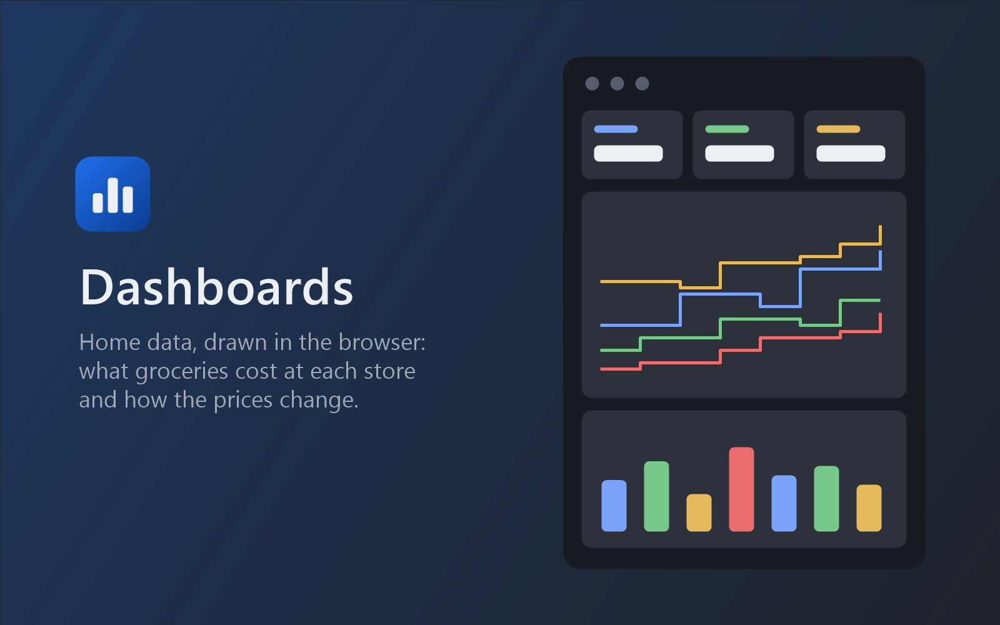
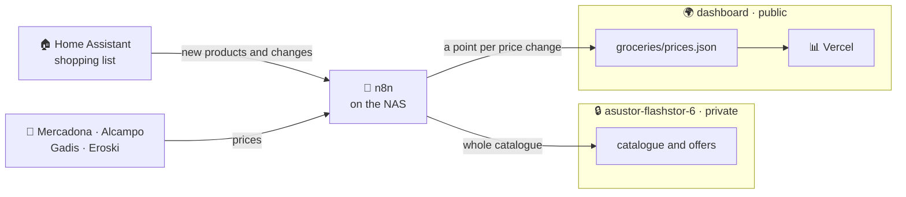

<div align="center">


# Dashboards

**Dashboards of home data, served with Vercel**

[](https://dashboard.moilolon.com/)

[](#-how-it-works)
[](https://n8n.io/)
[](https://www.home-assistant.io/)



</div>

---

## ✨ What this is

A static site with **dashboards that draw data from home**. There is no server and no
build step: what is on `main` is the site. The data is not edited here by hand: n8n
writes it from the NAS at home, and each dashboard reads it when it loads.

| | Dashboard | What it shows |
|---|---|---|
| 🏠 | [**Summary**](https://dashboard.moilolon.com/) | A card per dashboard with its figures, and alerts of what has changed |
| 🛒 | [**Groceries**](https://dashboard.moilolon.com/groceries/) | What each product costs at Mercadona, Alcampo, Gadis and Eroski, which store is cheapest and how the prices change |

---

## 🧭 How it works



- **Publishing.** Vercel serves `main` as it is. Every commit is live in a few seconds,
  including the ones n8n makes after each reading of the prices (`Prices: N changes`).
- **One dashboard per folder**, with its page, its script and its data file. The charts
  are hand-written SVG: no libraries to update.
- **Settings** (language, theme, light or dark, menu, width) are saved in each visitor's
  browser. Language and mode are shared with the other moilolon.com sites through two
  cookies of the domain.
- **Embedding.** `?embed=1` hides the menu, to show a dashboard inside another page such
  as a Home Assistant view; the same address can fix its language and mode.

---

## 🔐 What is public

This repo and its site are **public**, so only what each store already shows of an
article gets here: its name, code, photo and prices, with its name, unit and category in
the catalogue. The quantities, the suggestions and the rest of the catalogue stay in the
private repo. Whatever is published stays in the history even if it is deleted later, so
each new piece of data is decided before it is added.

The pages ask search engines not to index them, but anyone with the address can see them.

---

## 🚀 Getting started

The browser needs a server to read the JSON files:

```bash
python -m http.server 8765
```

Then open `http://localhost:8765/`.

---

<div align="center">
<sub><a href="https://moilolon.com">moilolon.com</a> · <a href="https://github.com/moilolon">@moilolon</a></sub>
</div>
